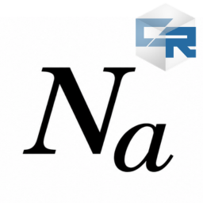

  
  <h1>Avogadro for Cleanroom</h1>
  

    
    
    
    
  

3D molecule previews, atom inspection, and GIF/MP4 exports for Minecraft 1.12.2.
Register your own structures through JSON, Java, or GroovyScript.

## Install

Requires **Cleanroom 0.7.4-alpha** and **ModularUI 3.1.6**. Put the Avogadro JAR
in `mods/`; use matching client/server versions. HEI and world HUD integrations
are optional. The library ships without registered molecule examples.

## Guides

- [Guides and Java API](https://neeols.github.io/avogadro-cleanroom/)
- [Theme Creator](tools/theme-creator/README.md)

## Build

Use Java 25 and `./gradlew build themeCreatorJar`. Supply the mapped
OffscreenCleanroom 0.1.1 compile dependency in `libs/` as described in the
[build guide](https://neeols.github.io/avogadro-cleanroom/io/github/wurtzitane/avogadro/api/doc-files/build.html).
Native Javadoc, including examples and Theme Creator internals, is generated by
`./gradlew javadoc` in `build/docs/javadoc/`.

## Credits

Original mod: Trifectum Software. Cleanroom port: wurtzitane. [MIT license](LICENSE).
Element reference data: [PubChem](https://pubchem.ncbi.nlm.nih.gov/rest/pug/periodictable/JSON)
and [Britannica](https://www.britannica.com/science/periodic-table).

Gemini was used to add Javadoc comments.